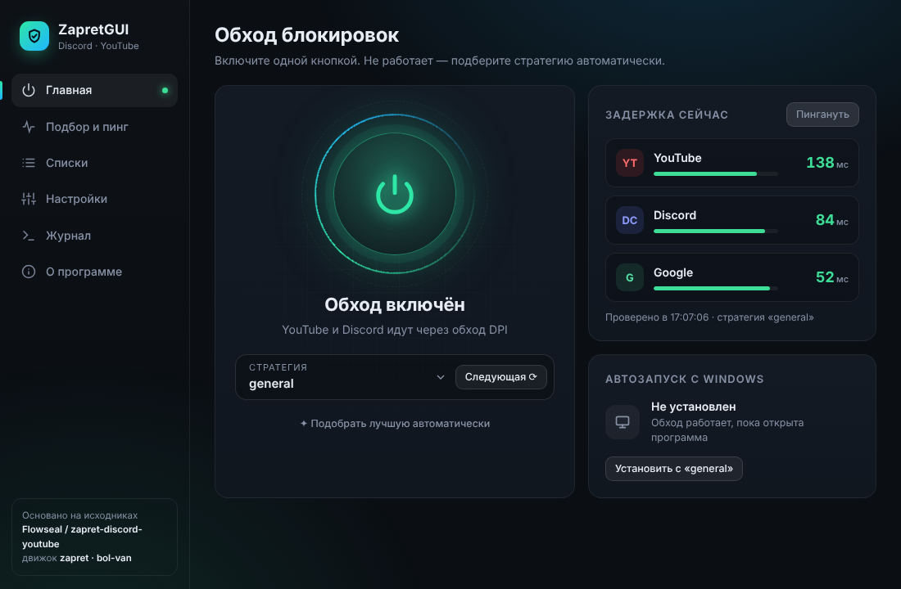
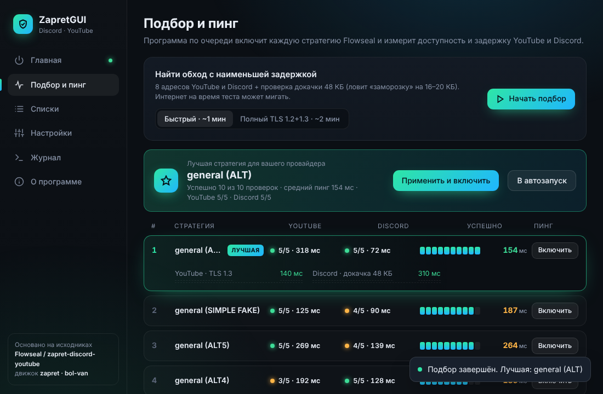

# ZapretGUI

Удобная графическая оболочка для обхода DPI-блокировок **Discord** и **YouTube** на Windows — с автоподбором стратегии по пингу.

> ### ❤️ Основано на [Flowseal / zapret-discord-youtube](https://github.com/Flowseal/zapret-discord-youtube)
> Все стратегии (`general*.bat`), списки доменов и IP, `winws.exe`, `WinDivert` и fake-пакеты взяты из репозитория **Flowseal** без изменений
> (версия 1.10.4, коммит в [`assets/flowseal-commit.txt`](assets/flowseal-commit.txt)).
> Движок обхода — [**zapret от bol-van**](https://github.com/bol-van/zapret).
> ZapretGUI лишь заменяет `.bat`-файлы и консольное меню `service.bat` на окно с кнопками. Спасибо авторам!



## Скачать

Готовый `ZapretGUI.exe` — в разделе [**Releases**](../../releases/latest). Один файл, установка не нужна.
Запускается с правами администратора (их требует WinDivert). Нужен Microsoft Edge WebView2 Runtime — он есть в Windows 11 и обновлённой Windows 10.

## Возможности

- **Включение одной кнопкой**, выбор любой из 22 стратегий Flowseal, «Следующая» для быстрого перебора.
- **Подбор и пинг**: программа по очереди включает каждую стратегию, проверяет 8 адресов YouTube/Discord (TLS 1.3, в полном режиме ещё TLS 1.2) и докачку 48 КБ (ловит «заморозку» на 16–20 КБ), меряет задержку и показывает лучшую. Кнопка «Пингануть» — задержка прямо сейчас.
- Служба автозапуска с Windows (та же служба `zapret`, что создаёт `service.bat`).
- Игровой фильтр (TCP/UDP, свои порты) и IPSet-фильтр (none / any / loaded), обновление списка IP с GitHub Flowseal.
- Редактор своих списков: `list-general-user.txt`, `list-exclude-user.txt`, `ipset-exclude-user.txt`.
- Очистка кэша Discord, проверка новых версий Flowseal, журнал winws, значок в трее, 6 цветов интерфейса.



## Сборка из исходников

Нужен Go 1.21+, собирается с любой ОС:

```
go mod tidy
GOOS=windows GOARCH=amd64 CGO_ENABLED=0 go build -trimpath -ldflags "-s -w -H windowsgui" -o ZapretGUI.exe .
```

`rsrc_windows_amd64.syso` (манифест с правами администратора + иконка) уже в репозитории; пересоздать:
`go install github.com/akavel/rsrc@latest && rsrc -manifest zapretui.manifest -ico app.ico -arch amd64 -o rsrc_windows_amd64.syso`.

Обновление до новой версии Flowseal: замените файлы в `assets/` содержимым его свежего релиза
(`general*.bat` → `assets/strategies/`, `bin/`, `lists/`; `ipset-all.txt.backup` → `assets/lists/ipset-all.full`) и пересоберите.

| Файл | Что внутри |
|---|---|
| `strategy.go` | разбор `.bat` Flowseal, подстановка путей и портов |
| `system_windows.go` | распаковка файлов, запуск winws, служба, IPSet, кэш Discord |
| `app_windows.go` | окно WebView2, связь с интерфейсом, подбор стратегии |
| `probe.go` | проверки доступности и задержки |
| `tray_windows.go` | значок в трее |
| `ui/index.html` | интерфейс (HTML/CSS/JS); открывается и в обычном браузере с тестовыми данными |
| `assets/` | оригинальные файлы Flowseal + его лицензия |

## Благодарности и лицензия

- [Flowseal / zapret-discord-youtube](https://github.com/Flowseal/zapret-discord-youtube) — стратегии, списки, сборка под Windows.
- [bol-van / zapret](https://github.com/bol-van/zapret) — движок обхода DPI.
- [WinDivert](https://github.com/basil00/WinDivert) — перехват пакетов.

MIT — см. [LICENSE](LICENSE) и [assets/LICENSE-Flowseal.txt](assets/LICENSE-Flowseal.txt).
